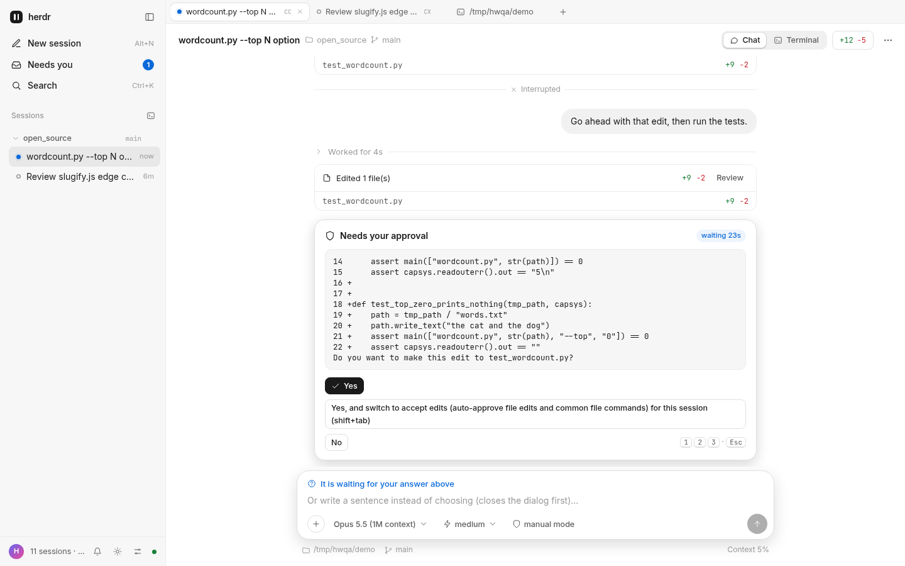
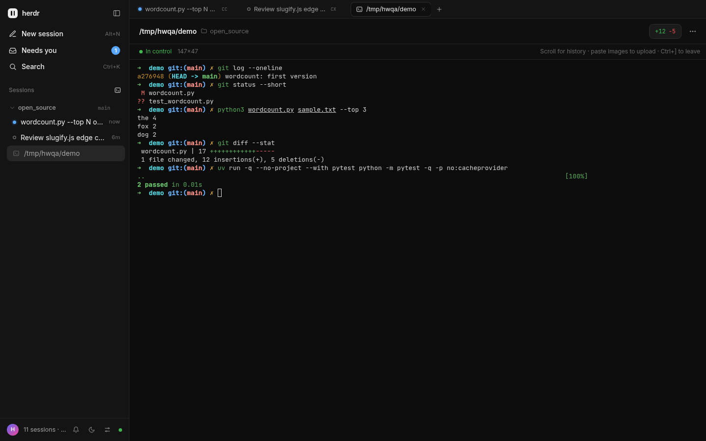

<div align="center">

# herdr-web

**Your Claude Code and Codex sessions in [herdr](https://herdr.dev), as a chat app in the browser.**

[](https://github.com/FL-Penly/herdr-web/actions/workflows/ci.yml)
[](LICENSE)

English · [简体中文](README.zh-CN.md)

</div>

herdr runs your coding agents in terminal panes. herdr-web shows the same sessions as threads you can read,
answer and steer from any browser, including your phone. The agents keep running in herdr: the web UI reads
their transcripts and screens, and types into their panes the way you would.

<picture>
  <source media="(prefers-color-scheme: dark)" srcset="docs/assets/chat-dark.png">
  
</picture>

## Features

- **Every session in one sidebar.** All Claude Code and Codex panes across your herdr workspaces, with live
  status, git branch, the current activity and how long it has been running.
- **An inbox for what needs you.** Permission prompts, questions, open dialogs and finished turns rise to the
  top with a count in the tab title, a toast, an optional sound and a desktop notification. Mark one handled or
  snooze it for an hour.
- **Threads, not scrollback.** Replies are read from the transcript (Claude) or rollout (Codex) and rendered as
  Markdown. Tool calls are grouped and collapsible, with diffs for edits, and goals (`/goal`) show as a bar.
  While an agent works, the reply it is writing streams in from its screen; a proposed plan shows in full.
  Codex does not say which rollout a pane writes, so it is inferred and checked against the terminal; if a pane
  still shows another conversation, *Sync conversation…* in its ⋯ menu sets it right.
- **Answer from the browser.** Allow or deny permissions, pick an option or type your own answer to
  `AskUserQuestion` (with several questions: which are answered, and every answer before you submit), answer
  Codex's queued questions while it keeps working, or press `1`–`9` / `Esc`.
- **A real composer.** Reply, add instructions to a running turn or queue a message for when it ends (the same
  for Claude Code and Codex: edit, delete or send it now from the list), stop it and get your message back,
  switch model and reasoning effort, switch the mode with Shift+Tab or a tap on its chip, and use `/` to search
  built-in commands, your own commands and skills.
  Paste or drop images and files: they upload and go into the message where you put them, as `[图片1]` capsules,
  so the agent knows which picture you mean.
- **The terminal when you want it.** Each pane is one keystroke away as a full xterm.js terminal, resized to
  your window while you are on it (watched read-only if another browser has it), with a key bar for `Esc`, `Tab`, `Ctrl-C` and arrows on touch screens. Selecting
  copies, *Quote in message* takes the selection into your reply, and *Find* searches the pane's text. A
  command that opens a panel in the terminal (`/config`, `/mcp`, …) switches there and back by itself.
- **Open what the agent points at.** Click a file path in a reply or in the terminal: pictures, video, PDFs,
  Markdown and code (at the line it names) open in a viewer, anything else downloads.
- **Review changes.** See the working tree's diff, new files in full, and send review comments back to the agent.
- **Fork from any reply.** Branch a session from the end or from an earlier reply into a new tab or split, via
  the bundled [quick-fork](plugin/quick-fork) plugin. A Claude Code fork keeps the session's flags and
  environment; a Codex fork keeps its environment.
- **Start new sessions.** Pick a folder (recent ones are offered, paths complete as you type): the session
  joins the workspace already working there, or gets a new workspace named after the folder (rename it, or
  pick another workspace). Choose Claude Code, Codex or a plain shell, a model and an effort, and write the
  first message; it is sent once the agent is ready. Rename a workspace by right-clicking (or long-pressing) its name in the sidebar.
- **Find your way in long threads.** The prompt of the turn you are reading stays pinned on top, a click goes
  back to it, and an answer copies as Markdown or plain text.
- **Watch your plan limits** (optional). Settings → *Subscription usage* shows what is left of the 5-hour and
  weekly limits of the Claude Code and Codex subscriptions signed in on the host. It asks Anthropic and OpenAI
  with those sign-ins, read-only, and is off until you turn it on.
- **Comfortable anywhere.** Light and dark themes, a phone-first layout you can add to the home screen
  ([On your phone](#on-your-phone)), a command palette (`Ctrl/⌘ K`), and an English or Chinese UI picked
  from your browser.



## Requirements

- [herdr](https://herdr.dev) 0.9.5 or newer, running on the same machine
- [Bun](https://bun.sh) 1.3.7 or newer (older versions answer a WebSocket handshake with a duplicate header browsers reject)
- [Claude Code](https://docs.anthropic.com/en/docs/claude-code) and/or [Codex CLI](https://github.com/openai/codex)
- Linux. macOS works with two gaps, both because there is no `/proc`: forks don't inherit the original
  session's environment, and Codex sessions may be matched to their panes less precisely.

## Quick start

```sh
git clone https://github.com/FL-Penly/herdr-web.git
cd herdr-web
bun install
bun start
```

Open the URL it prints. It carries the access token after `#t=`: the page signs in with it, keeps it in that
browser, and removes it from the address bar. The token sits in the URL's fragment, which browsers never send
to the server or to a proxy. The link keeps working until you rotate the token, so treat it like a password.
If you started herdr-web without a terminal (systemd, nohup), get the URL with `bun run url`. Opening the
address without the token shows a sign-in screen. Paste the token there (or the whole link). On the host,
`bun run url` or `cat ~/.config/herdr-web/token` prints it.

## Remote access and security

herdr-web can type into every pane herdr runs. Whoever can reach it can run commands as you. Treat it like SSH.

- It listens on `127.0.0.1` by default. Every request needs the access token, which is generated once into
  `~/.config/herdr-web/token` (mode `0600`). Delete the file and restart herdr-web to rotate it.
- To reach it from another device, prefer one of these, in this order:
  1. an SSH tunnel: `ssh -L 12500:127.0.0.1:12500 your-host`, then open `http://localhost:12500/#t=…`;
  2. a private network such as Tailscale or WireGuard;
  3. a reverse proxy with TLS (Caddy, nginx) in front of `127.0.0.1:12500`.
- `HERDR_WEB_HOST=0.0.0.0` exposes the UI on every interface over plain HTTP. Do it only on a network you trust,
  and never with `HERDR_WEB_TOKEN=off` (the server refuses that combination).
- There is no cookie. The browser keeps the token in its local storage for this origin (scheme, host *and*
  port), so a page served from another port of the same host cannot read it, and sends it with each request
  (`Authorization: Bearer …`, and a WebSocket subprotocol for the sockets). The app shell itself (HTML, scripts,
  styles, icons) holds no secrets and loads without it. WebSocket upgrades and state-changing requests from
  another origin are rejected as well. *Sign out* in the settings menu forgets the token on that device.

See [SECURITY.md](SECURITY.md) for the threat model and how to report a vulnerability.

## On your phone

herdr-web is built to supervise and drive your agents from a phone. Open the login link on the phone once
(see above for how to reach the host), or open the address and paste the token into the sign-in screen. The
phone's browser remembers it.

- **Add it to the home screen** for a full-screen app: Safari's Share → *Add to Home Screen* on iPhone, or
  Chrome's menu → *Add to home screen* / *Install app* on Android. An iPhone home-screen app has its own
  storage, so the first time it opens the sign-in screen: paste the login link (`bun run url`) or just its token.
- **Navigate with your thumb.** Swipe right from the left side of the screen for the session list, tap the
  blue inbox button for what needs you, long-press a session or a tab for its menu (copy the pane ID or the
  dispatch command, rename). Back closes the topmost drawer, sheet or panel.
- **Answer and reply.** Permission and question cards have full-width buttons. In the composer, Return makes
  a new line and the round button sends (or stops the agent). `+` attaches a photo straight from the camera.
- **The terminal** has a key row (Esc, Tab, Ctrl, Alt, Shift, ^C, arrows, Enter; a modifier holds for the
  next key, double-tap to keep it held), an input line for writing a command before sending it (handy with
  Chinese input), text size buttons and a *select text* view for copying. Typing takes control of the pane
  and resizes it to the phone's width.
- **Keep screen on** in settings keeps the phone awake while herdr-web is open (needs HTTPS or localhost).
- **Notifications:** turn on *System notifications* in settings. Browsers only allow them over HTTPS or on
  `http://localhost` (an SSH tunnel counts), and a phone delivers them only while herdr-web is still running
  in the background; there is no push server.

A phone is usually not on the herdr host, so this is remote access: everything in the section above applies.
Prefer Tailscale/WireGuard or an HTTPS reverse proxy over exposing plain HTTP on a shared network, and treat
the login link like a password (the phone keeps the token until you sign out or rotate it).

## Configuration

Everything is set through environment variables. [`src/config.ts`](src/config.ts) is the only place in `src/`
that reads them (the quick-fork plugin has its own fallbacks for when it runs standalone).

| Variable | Default | Description |
| --- | --- | --- |
| `HERDR_WEB_HOST` | `127.0.0.1` | Interface to bind. `0.0.0.0` makes it reachable from other machines. |
| `HERDR_WEB_PORT` | `12500` | Port to listen on, an integer from 1 to 65535. |
| `HERDR_WEB_TOKEN` | generated | Fixed access token: 16 characters or more, letters, digits and `-_.~` only. Unset: generated once into `<config dir>/token`. `off` disables auth and is only accepted on a loopback host. |
| `HERDR_WEB_CONFIG_DIR` | `$XDG_CONFIG_HOME/herdr-web` (`~/.config/herdr-web`) | Token and inbox state. |
| `HERDR_WEB_HIDE_WORKSPACES` | empty | Comma-separated herdr workspace labels to hide, e.g. `Board,Wake`. |
| `HERDR_WEB_CLAUDE_DIRS` | empty | Extra Claude config dirs to search for transcripts, separated by `:`. |
| `HERDR_BIN_PATH` | `herdr` | The herdr binary. |
| `CLAUDE_CONFIG_DIR` | `~/.claude` | Claude Code's config dir: transcripts, settings, commands and skills. |
| `CLAUDE_CODE_EFFORT_LEVEL` | unset | The effort Claude Code uses by default, shown when a session hasn't set one. |
| `CODEX_HOME` | `~/.codex` | Codex's home: rollouts, config, prompts, skills and the model cache. |
| `XDG_RUNTIME_DIR` | unset | Uploads go to `$XDG_RUNTIME_DIR/herdr-web/uploads` (`0700`), or `$XDG_CACHE_HOME/herdr-web/uploads` (`~/.cache/herdr-web/uploads`) without it. Uploads are capped at 25 MB, and those older than a week are deleted at startup and, at most hourly, on later uploads. |

## Run it as a service

A systemd user unit is in [`contrib/systemd/herdr-web.service`](contrib/systemd/herdr-web.service):

```sh
cp contrib/systemd/herdr-web.service ~/.config/systemd/user/
# edit WorkingDirectory and PATH if your clone or bun live elsewhere
systemctl --user daemon-reload
systemctl --user enable --now herdr-web
loginctl enable-linger "$USER"   # keep it running after you log out
bun run url                      # the login URL
```

`bun run url` builds the link from your shell's environment, so if you set `HERDR_WEB_*` variables in the unit,
set the same ones in the shell. It only reads the token: if herdr-web has not created one yet, it says so and
exits.

## The quick-fork plugin

The fork button uses [`plugin/quick-fork`](plugin/quick-fork), which also works on its own as a herdr plugin with
"fork right / down / new tab" actions for the focused pane:

```sh
herdr plugin install FL-Penly/herdr-web/plugin/quick-fork
# or, from this clone:
herdr plugin link "$PWD/plugin/quick-fork"
```

## How it works

A Bun server polls `herdr api snapshot` once a second, reads each agent's screen and transcript, works out who
needs you, and pushes the result over a WebSocket. Threads come straight from Claude's transcripts and Codex's
rollouts. Actions turn into `herdr agent prompt` / `pane send-keys` calls with key sequences that are tested
against real TUI screens. The terminal view streams `herdr terminal session`. The browser side is plain ES
modules with no build step.

More in [docs/architecture.md](docs/architecture.md).

## Development

```sh
bun install
bun run dev      # restarts on change
bun run check    # typecheck, lint and tests
```

[CONTRIBUTING.md](CONTRIBUTING.md) covers the layout, the conventions and how to add a test when Claude Code or
Codex change their TUI.

## License

[MIT](LICENSE)
