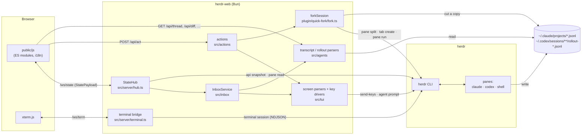

# Architecture

herdr-web is a single Bun process with no database and no build step. herdr is the source of truth for what
runs where. The agents' own files are the source of truth for what was said. herdr-web reads both, works out
what needs you, and turns your clicks back into herdr commands.

## Layout

| Path | Job |
| --- | --- |
| `src/main.ts` | Entry point: config, auth, the state hub, `Bun.serve`, shutdown on `SIGTERM`, `--print-url`. |
| `src/config.ts` | Every environment variable, in one frozen object: the only module under `src/` that reads `process.env` (the quick-fork plugin has its own fallbacks for running standalone). |
| `src/protocol.ts` | The wire types shared by server and browser: `StatePayload`, `AgentView`, `Thread`, `Action`, … |
| `src/herdr.ts` | A typed client for the herdr CLI, with timeouts and `HerdrError`. |
| `src/lib/` | Small generic helpers: `exec` with a timeout, a TTL cache, file reads (with an mtime-keyed parse cache), an incremental JSONL reader, a per-key mutex, frontmatter, git branch and diff. |
| `src/agents/` | Everything read from Claude Code's and Codex's own files: finding a pane's transcript or rollout, parsing it into turns, the last reply, slash commands and skills, model catalogs, default effort. |
| `src/tui/` | Pure parsers for an agent's screen (status line, dialogs, menus, the input box, slash-command output) and the drivers that send key sequences to a live pane. |
| `src/inbox/` | Decides which agents need you and why, and remembers what you acknowledged or snoozed. |
| `src/server/` | HTTP plumbing: bearer-token auth, the JSON envelope, static files and `/vendor`, routes, the state hub, uploads, the terminal bridge, queued first messages, folders for new sessions. |
| `src/actions/` | One typed handler per `/api/act` operation: sessions, replies, dialogs, inbox, fork. |
| `public/` | The browser app: `index.html`, CSS, and native ES modules under `public/js` (no bundler). |
| `plugin/quick-fork/` | The fork logic, usable both in-process and as a standalone herdr plugin. |
| `test/` | `bun test`, mirroring `src/`, with synthetic fixtures under `test/fixtures/`. `test/setup.ts` (preloaded via `bunfig.toml`) points every home and config dir at a temp dir. |

## The state loop

`StateHub` owns the only polling loop. Once a second (`config.tickMs`) it:

1. reads `herdr api snapshot` (workspaces, tabs, panes, agents, layouts);
2. builds an `AgentView` for each agent pane herdr reports through `InboxService` (transcripts and dialogs
   for Claude Code and Codex). That reads the pane's screen (`herdr pane read`), parses the status line and any dialog, finds the transcript, takes the last
   reply, and looks up the git branch. Slow lookups are cached with a TTL;
3. projects all of it into a `StatePayload` (`src/server/payload.ts`, a pure function), leaving out the
   workspaces in `HERDR_WEB_HIDE_WORKSPACES`;
4. publishes the payload on the `state` topic, which every `/ws/state` socket subscribes to, but only when it
   changed.

Refreshes are single-flight. An action that changes something calls `hub.refresh()`. If a tick is running,
the call waits for it and runs one more, so two ticks never overlap and an older one can never overwrite a
newer one. The `FirstMessageQueue` rides on the same tick. When a new session's screen has been ready for input
for two ticks, it sends the queued message with `herdr agent prompt` under the pane's lock (see below). The
message stays in `StatePayload.firstMessages` as `queued` until it is delivered. Under the lock, right before sending,
it checks that the same entry is still queued: a dismiss, a new message for the pane, or a reply that went
through while the screen was read or the lock awaited cancels the send. If the send fails, it becomes
`failed` and is not retried: a timeout may have delivered it after all. If the agent never gets ready within 15
minutes, it becomes `failed` with `expired`. The browser shows a failed message with *Send again* (a normal
reply, which also clears it) and *Dismiss* (`dismissFirstMessage`).

`ReplyQueues` rides on the same tick, for messages queued behind a running turn (`queueReply`). Claude Code
has no queue that waits for the turn to end (its Enter and `ctrl+x enter` both deliver at the next tool call),
and Codex's (Tab) cannot be read back or edited from here, so herdr-web keeps one for both. A pane's first
message goes once the agent is idle and its screen ready for two ticks, through `sendQueued`: under the pane's
lock, with the input box on screen (nothing is closed to get there) and empty. Text typed in the terminal holds
the queue (`held: 'terminal_draft'`) until it is gone. After a send, the next waits until the agent was seen
working, or 8 seconds for a message that starts no turn. A web interrupt pauses the queue, and so does a failed
send, which is not retried. Each queue remembers the conversation it was written for, by session id from the
pane's transcript (which follows Claude Code's `/clear` and `/resume`, and Codex's `/new` once that has a
message): when the pane shows another, the queue pauses (`session_changed`) and going on sends into the new one.
Nothing is sent while the conversation is unknown. Codex writes no file for `/new` until its first message, so
that change cannot be seen; it is typed in the terminal, though, and a queue that text in the terminal held,
when that text goes away with no turn seen since (no `working`, no rise in herdr's `completion_seq`), pauses
(`terminal_input`) instead of sending; that state is saved too, as the terminal may change while the server is
down. Right before
typing, under the pane's lock, the queue checks again that the message is still first and nothing paused it.
The queues are saved in `queue.json` in the config folder, with why one stopped, and the message being typed is
marked there first: a server that stopped midway comes back paused with `maybe_sent`, and a queue that cannot
be saved sends nothing.

## What needs you

`InboxService` turns one agent into at most one `InboxEntry`, from the most to the least specific source:

- `dialog`: a blocking dialog on screen. Permission prompts, the trust-this-folder dialog, `AskUserQuestion`
  and any numbered or arrow-key menu, with its options and question (a trust card words its own body, but
  still sends the question back, so a click is checked like any other). An `AskUserQuestion` of several
  questions (one tab each, then a submit tab) also has `form`: which questions are answered, and on the submit
  tab what was chosen, which Claude gets only once submitted; there the question is those answers, so a submit
  is checked against the answers the browser showed.
- `asks`: Codex has async questions queued while it keeps working.
- `menu` / `panel`: something you opened yourself (`/model`, `/status`). Shown, but not counted as waiting.
  Codex's full-screen `/resume` picker is a menu too, although herdr reports the pane `blocked` while it is open.
- `transcript` / `screen`: the turn finished. The message is the last reply from the transcript, or from the
  screen when there is none. Background shells Claude Code still runs (`AgentView.shells`, counted from its
  footer) do not change that: its terminal says the turn is done, and adds how many still run.

Acknowledgements and snoozes are keyed to the moment the agent stopped, so a new turn needs you again. They
are stored atomically in `<config dir>/state.json`.

## Threads

`GET /api/thread?pane=…` finds the pane's file and parses it into turns (`Thread` in `protocol.ts`):

- **Claude Code** writes `~/.claude/projects/<project>/<session>.jsonl`, one row per content block. Which session
  a pane shows comes first from the registry each running Claude Code process keeps,
  `~/.claude/sessions/<pid>.json` (the pid from `herdr pane process-info`): its `sessionId` follows `/resume` and
  `/clear` inside the TUI. A process can show a background job instead, whose session is in
  `~/.claude/jobs/<id>/state.json`: the one its own session last opened with `/resume` (its transcript ends in
  `Opening "…", running in the background (<id>)`, and the registry keeps the process's own session), or else
  the job it sent its conversation to (`parkedJobId`). herdr's session id, which stays the one the process started with, is the
  fallback. Finding the file is then a lookup, with hits cached and misses retried.
- **Codex** writes `~/.codex/sessions/YYYY/MM/DD/rollout-<time>-<id>.jsonl`, but herdr does not know which
  one a pane uses. `src/agents/codex/locate.ts` matches by `codex resume <id>` / `codex fork <id>` in the
  process's argv, then by folder and the process's start time. The mapping sticks once made, and two panes
  never claim the same rollout. Every state tick tells the locator which Codex panes are alive, working ones
  included (nothing looks those up), so a closed pane stops claiming and a busy sibling still counts as a
  possible owner. `/new` inside Codex is followed to the newer file once it is ten seconds old (a `codex fork`
  in a new pane writes its rollout at once, before herdr reports that pane), but only while no other live Codex
  pane is in that folder, and never to a file created while another Codex pane of that folder was alive, even
  one that has closed since (the locator keeps when each pane was alive). Neither the process nor its logs say
  which file it writes (Codex 0.164's TUI hands the session to a shared app-server daemon, which keeps every
  loaded rollout open), so a rollout guessed by time is checked against the screen: among the interactive
  rollouts of the folder appended to since the process started, the one whose newest user message is the
  newest one echoed there becomes the pane's, as proven; with none or several, the guess stands. When the web
  still shows the wrong conversation, *Sync conversation…* (the pane's ⋯ menu) lists those rollouts, marks the
  one the terminal echoes, and pins the one picked (`pinSession`). A mapping that was named (`codex resume <id>`, which forks from a reply also use) or
  proven by the screen is never replaced by a newer file in the folder: another Codex outside herdr may have
  written it. Codex's in-TUI `/resume` moves the process to an older rollout that changes only with the next
  message, so after that message a pane follows the rollout whose newest user message is, all of it, the one
  its screen echoes last. Prompt text is weak evidence, so nothing is guessed: the candidates are interactive
  rollouts in the pane's folder appended to after its own, exactly one of them may match (rollouts other panes
  show count toward that but are never taken), its message must be newer than the pane's own newest one, and
  an echo cut short with `…` matches only as a unique prefix. Otherwise the pane keeps its rollout. Until then the pane keeps showing the previous thread. The same evidence moves an
  explicitly resumed pane after `/new`. A
  fork's rollout only references its parent, so the parent's history is read and put in front. Since Codex
  0.164 a resumed session also goes on in a new file, a segment named `rollout-<time>-<session>_<segment>.jsonl`
  whose `history_base` is the segment before it: the session id is the first uuid in the name, a session id
  resolves to its newest segment, a pane moves to a newer segment of its own session, and a `history_base`
  resolves to the newest segment of that session started before the file (the id index is rebuilt when it
  predates that file, so it never skips a segment written since).

Parsers read files incrementally (`JsonlTail` remembers the byte offset), so polling a long session costs only
what was appended. History has three limits: the first read of a transcript starts 30 MB from its end, a
parser keeps at most 4000 items, and `/api/thread` returns at most `MAX_TURNS` (1000) turns, exported as
`meta.maxTurns`. `more` counts only the older turns a larger `turns` would return. Anything beyond the limits
sets `meta.truncated`, and the thread then says that earlier history isn't shown instead of offering to load
it. Each reply carries a `forkAt` mark: the Claude message uuid, or `<rollout>#<byte offset>`
just after Codex's `task_complete`.

### The reply in progress

A transcript gets a message only once it is complete, so while an agent works `/api/thread` also reads the
pane (`herdr pane read --source recent-unwrapped --ansi`) and `src/tui/live.ts` takes the reply off the screen: the
last message block after the newest prompt echo (`❯` for Claude Code, `›` for Codex, including the prompt
Codex pins to the top row), above the spinner and the input box, and only when it is text, not a tool call. It
is unwrapped back into paragraphs, and drawn tables (Claude's `┌─┬─┐` boxes, Codex's `━━━`/`───` rules, split
by display width) become markdown tables. Claude Code keeps the message it is writing out of scrollback, so a
long reply can start above the screen; the text then begins with `…`. It is at most 8 KB, newest part kept.
Every read of
history passes `--ansi` (and strips it): as plain text, herdr 0.9.5 gets the rows above the screen of an idle
Claude Code or Codex by scrolling the app up with wheel events and back, which the user sees in herdr's own
view. Reads of idle panes (the inbox's screen reply, `/resume` detection, slash command output) take only the
visible screen.
It goes out as `meta.live` unless the newest turn already holds the same text, compared on letters and digits
only because the screen shows rendered markdown. The browser polls the thread faster while the agent works and
drops the preview once the transcript has the reply.

## Review

`GET /api/diff?pane=…` diffs the pane's work tree against `HEAD` (or the index in a repository without
commits) and adds every untracked file that is not ignored, up to 50: a text file up to 256 KB as a git-style
`new file` patch, a binary one as git's `Binary files … differ` line, a larger one as a stub saying it is too
large to show. Their lines count in the totals. Paths are not quoted (`core.quotePath=false`), so the patch
headers match the file list.

The panel polls the diff and repaints only when its content changed: the file list with its counts, the
patch's length and a 53-bit hash of the patch text (`diffSignature` in `public/js/diff.js`), since an edit can
keep both length and counts. *Refresh* always repaints. A repaint keeps the selected file and the scroll
position in it.

## Files, pane text and usage

`GET /api/file?pane=…&path=…` serves a file an agent named for the viewer (`public/js/viewer.js`): `~/…`,
absolute, or relative to the pane's folder, up to 64 MB, with `nosniff` and a sandboxing CSP so nothing in it
runs. The token is a header, so the browser fetches it and shows a blob; the same goes for pictures a reply
embeds from this machine. Anyone holding the token can already run commands in the panes, so any file the
user can read is fair game.

`GET /api/pane-text?pane=…` is the pane's text for *Find* in the terminal: up to 5000 lines, read with
`--ansi` and stripped like every read above the screen.

`GET /api/usage` (`src/server/usage.ts`) reads the Claude Code (`.credentials.json` in `~/.claude`,
`CLAUDE_CONFIG_DIR` and `~/.claude-*`, the keychain on macOS) and Codex (`auth.json` in `CODEX_HOME`,
`~/.config/codex`, `~/.codex` and `~/.codex-*`) sign-ins and asks each provider's usage endpoint, as
[OpenUsage](https://github.com/robinebers/openusage) does. Tokens are never refreshed: both tools rotate refresh
tokens, and a refresh they did not make would sign them out. Answers are cached for five minutes (`?refresh=1`:
30 seconds), a 429 waits for its `Retry-After`, and the browser asks only while the meter is on and the page is
visible.

## Approval cards

A permission card shows the change it asks about from the thread: the oldest still-`running` edit of the last
turn whose file the prompt's question line names (`Do you want to create routes.js?`), or the running command
the prompt starts with (`pendingChange` in `public/js/model.js`). Claude Code shows the prompt before it
writes the assistant message holding the tool call to the transcript: a moment later for a single call, once
the whole message has streamed for several, and sometimes not until the prompt is answered. Until then only
the screen has the change, and a file or diff taller than the pane shows only its end there. A question that
opens on a preview row instead of the dialog's title is such a tail (`isCutPreview`). The card says so, and
if the transcript still lacks the change 1.2 s later it asks for the rest (`revealDialog`, `needsReveal`):
Claude Code draws the prompt in a full-screen view that keeps what does not fit, so under the pane's lock
the server pages that view up with PageUp until the dialog's top rule shows, stitches the pages where they
overlap (`src/tui/reveal.ts`, which also joins rows the TUI wrapped) and sends ctrl+End to go back. Neither
key answers the dialog or moves its cursor. While the view is paged, the inbox keeps the pane's last view
(`whileScrolled`), because herdr, which reads the screen too, briefly reports the agent `done`. The card then
shows the whole change, read from the terminal, and swaps in the transcript's version once that arrives (the
thread is polled every 0.7 s while it waits). If the top cannot be reached (about 400 rows), the card keeps
saying it shows only the end and offers *Open in terminal*. Only permission prompts are read (`not_permission`).

What the screen shows does not identify a proposal: Claude can recreate a file with another first line and
the same last rows, and ask the same question. So the text is kept per *episode* of a dialog
(`InboxEntry.episode`, made by `InboxService`), from when it shows until it is answered or replaced. A new
episode starts when herdr's `state_change_seq` moved since the dialog was last seen (herdr saw the agent leave
it), when herdr-web typed into the pane (every `serial` action but `revealDialog` tells the inbox before and
after, and so does the terminal bridge on input; herdr can report two prompts in a row as one blocked spell),
or when the dialog asks something else. Paging the view makes herdr report `done` and then `blocked` under a
new seq: within a few seconds of the view being back, with nothing but `done` in between, that is bridged.
Keys typed in herdr's own client during that bridge are the one thing it cannot see. The browser sends the
episode with `revealDialog`; the server refuses any but the pane's current one (`stale_dialog`), reads once
per episode (`revealOnce`: browsers asking at once share the read, a failure is not kept), and drops the text
when the episode ends. The browser keeps one read per pane, shows it only for that episode and card, and
forgets it once the pane shows another episode. Ids carry a per-process prefix, so a restarted server never
hands out one a browser already holds.

## New sessions

`POST /api/act {op: 'new', workspace | newWorkspace, cwd?, request?, …}` opens a tab in `workspace`, or creates
a workspace labelled `newWorkspace` (`herdr workspace create`) and starts in the shell pane it comes with. `cwd`
must be an existing directory (`bad_cwd` otherwise) and is remembered in `<config dir>/dirs.json`, at most
twelve, newest first. Without `cwd` the tab opens in the folder of the workspace's first pane (home for a new
workspace). The browser picks the folder first and works out the workspace from it (`homeTarget` in
`public/js/model.js`): the first workspace in the sidebar with a pane in that exact folder, else a new one named
after the folder's last segment, unless the user picked a workspace or named a new one. A folder above does not
count, so a workspace opened in `~/projects` does not take every project. `GET /api/dirs` offers the remembered
folders, then those of the visible workspaces' panes, then home; with `?workspace=…`, that workspace's pane
folders come first. Both are deduped and keep only folders that still exist. `renameWorkspace` relabels a
workspace (`herdr workspace rename`).
`request` is an id the browser makes for each click (`fork` takes one too): a request that repeats one still
running, or one that succeeded within 30 s, gets that first `{pane}` back instead of opening another tab
(`ctx.requests`, a `TtlCache`; a failure is not kept). The browser also lets one creation per key run at a
time and holds the key for a double click's length after (`public/js/inflight.js`), as it does for dialog
answers, so a double click never answers the next, identical prompt.
`GET /api/complete?path=…` lists up to 50 subdirectories that complete the last segment of an absolute or
`~/` path (hidden ones only when the segment starts with `.`).

## Reading and driving the TUI

Everything that depends on how Claude Code and Codex draw their screens lives in `src/tui` and is tested
against screen fixtures. The parsers are pure functions of the screen text. They scope the status line to the
footer, cut out the dialog region, and recognize both the English and Chinese strings the TUIs print. The
drivers send key sequences with named delays: pick an option by digit or by moving the cursor, answer a Codex
async question, clear a restored input after an interrupt (Claude Code puts an unanswered prompt back; for
Codex, which never does, the rollout tells whether the turn had produced anything), dismiss a dialog before a
typed reply. They read the screen to decide what to send, and a named `DELAY` table holds their timings.

herdr types a reply at the input box's cursor, so text someone typed in the terminal and did not send would be
spliced around it. `reply` first reads the box with its attributes (`herdr pane read --ansi`, `inputDraft`):
both TUIs draw their placeholder and suggestions dim and typed text plain. A draft stops the send with
`terminal_draft` and the draft's text; the browser asks whether to replace it, and the resend's
`discardDraft` carries the text it showed. Someone may keep typing in the terminal while the browser asks, so
under the pane's lock the box is read again: if it no longer holds that text (whitespace aside), the send
stops with `terminal_draft` and the new text, and the browser asks again. Otherwise the box is emptied (down
to its last row, ctrl+e, then ctrl+u and backspace up each row, never up, which would recall history),
re-read, and the send fails rather than go into a box that did not empty. Queued
first messages go to a session no one has typed into, and an interrupt clears the prompt it restores.
An option label the TUI wrapped onto the next row (Claude's "Yes, allow reading from <folder> during this
session") is joined back: a row at the label's column continues it when the row above reached the screen's
edge, judged by the widest row on screen.

A click on an option names the option by its label and the dialog by its question, not by a position.
`chooseOption` re-reads the screen and finds that label. It checks that the dialog still asks the same question,
all of it (`sameText` in `src/tui/screen.ts`: whitespace, wrapping and box glyphs are ignored, and a question
the TUI cut short with a trailing `…` matches only text that goes on from exactly what it showed), so a
permission prompt whose command or target changed further down is another dialog. The question is every row of
the prompt in view, not just its last few. An async answer likewise needs the panel to show the whole question
under its `Question n/m` row. Then it computes the arrow moves from the cursor as it is now. If the dialog
changed, closed or lost the option, it sends nothing and fails with `stale_dialog`. Everything that types into a
pane (replies, options, keys, interrupts, async answers, queued first messages) runs under that pane's lock
(`KeyedMutex` in `src/lib/mutex.ts`), so two requests never interleave their key sequences.

## The terminal

`/ws/term?pane=…` spawns `herdr terminal session observe|control <pane>`, which speaks NDJSON on
stdin/stdout. The browser opens it with `mode=control` at its own size, so herdr resizes the pane to the
browser's terminal and restores it when the session ends; if another client holds the pane, herdr refuses and
the browser falls back to `observe`. The bridge forwards frames to xterm.js as binary messages and sends
keystrokes, pastes, resizes and clicks back. Frames do not say whether the program asked for the mouse, so the
browser sends every plain click as `terminal.mouse` (press and release at a 0-based cell); herdr encodes it the
way the program asked, or drops it. A drag stays in the browser as a selection. Sizes are clamped. When a slow client falls behind, frames are dropped and a full redraw is
requested once it catches up, so the server never buffers without bound.

## Forking

`POST /api/act {op: 'fork', pane, mode, at?}` validates the fork point, then calls `forkSession()` from
`plugin/quick-fork/fork.ts` in-process. There is no overall timeout: every herdr call inside it has its own. The same file is the quick-fork herdr plugin, so it
imports nothing from `src/`. It:

1. asks herdr for the agent and its foreground process, then reads that process's argv and, on Linux,
   `/proc/<pid>/environ`;
2. copies the transcript up to the reply `at` (for a whole Claude fork, its newest message) under a new
   session id, so the fork has its id and history at once. For Claude it keeps the rest of
   the assistant message and the tool results that answer it. For Codex it checks that the offset lies within the
   file and ends a completed turn (right after `task_complete` or `turn_aborted`), so a copy never ends on a tool
   call without its output, and rewrites only id fields;
3. creates the split or tab in the folder the session was recorded in;
4. writes the inherited `CLAUDE_*`/`ANTHROPIC_*` or `CODEX_*`/`OPENAI_*` variables to a `0600` file that the
   new shell sources and deletes, then runs `claude <same flags> --resume <copy>` (`--fork-session` only for a
   session with no messages yet) or `codex fork …`. If anything fails, the env file and the copied transcript are removed.

## The browser

`public/index.html` loads `public/js/main.js` as a module. The libraries (xterm.js, marked, DOMPurify, fonts)
are served from `node_modules` under `/vendor/…`. The modules are split by job: the state socket, the
sidebar, the thread, the composer, the terminal, the review panel, menus and the palette. Every visible string
goes through `t()` from `public/js/i18n`, which picks English or Chinese from the browser and can be switched
in settings. On phones (`MOBILE_QUERY` in `public/js/touch.js`, mirrored by the `@media` blocks in CSS) the
same modules switch to a drawer, bottom sheets and touch gestures (`gestures.js`), and `viewport.js` sizes the
app to the visual viewport so the on-screen keyboard never covers the composer. The service worker only shows
notifications: it neither caches nor intercepts `/api` or `/ws`. Signing in is part of the app (see
[Authentication](#authentication)), so it is translated like everything else. The browser keeps some state per pane for the session: where the reader was in each thread (the block at
the top edge and the offset into it, whether it followed new output, the turns loaded and what was expanded),
restored when the pane is opened again. Uploads run with progress and block sending until they finish. Type checking is opt-in per file: modules with logic (state, API, model, formatting, diff, i18n, …)
start with `// @ts-check`, import their types from `src/protocol.ts` through JSDoc and are type-checked by
`bun run typecheck`; DOM glue that only wires events to them does not.

## Authentication

The access token is a bearer credential scoped to herdr-web's origin. There are no cookies: a cookie is scoped to a host
name but not to a port, so any other service on the same host, on any port, would receive it.

- The browser keeps the token in `localStorage` under `herdr-web:token`. That storage belongs to the origin
  (scheme, host and port), so a page on another port cannot read it.
- Every `/api/*` request sends `Authorization: Bearer <token>`. A browser cannot set headers on a WebSocket, so
  `/ws/*` offers the subprotocols `["herdr-web", "bearer.<token>"]`. The server checks the bearer entry and
  answers with `herdr-web`, never with the token (Bun would echo the first offered protocol by itself); a
  handshake that offers subprotocols but not `herdr-web` is refused. Nothing else counts as a credential: not a cookie, not a query string.
- `src/server/auth.ts` `guard()` runs before every handler. `/api/*` and `/ws/*` need the token (401
  `{ok: false, code: 'unauthorized'}`, or a refused upgrade). The app shell and its static files (`/`,
  `/js`, `/css`, `/vendor`, icons, the manifest, `sw.js`, the favicon) need none: they hold no secrets. As
  defense in depth, upgrades and non-GET requests must also carry our own `Origin`. `GET /api/session` only
  checks the token.
- Without a stored token, or after any 401, the app shows a sign-in screen. It takes the token or a pasted
  login link and validates it with `/api/session`. `bun run url` prints `http://<host>:<port>/#t=<token>`:
  the token is in the fragment, which never reaches the server, a proxy or its logs. The page signs in with
  it, then removes it with `history.replaceState()`, also when the link is opened in a tab that already
  shows the app (only the fragment changes, so the page does not reload). *Sign out* in the settings clears the token and closes
  the sockets.
- `HERDR_WEB_TOKEN=off` turns auth off and is only accepted on a loopback host. Tokens are compared in
  constant time, and must be base64url-like (letters, digits, `-_.~`) to fit a header and a subprotocol.

## Wiring

No module does work when it is imported: `src/config.ts` reads the environment into a frozen object, and
everything else exports functions, classes and bounded caches. `src/main.ts` builds the long-lived pieces (the
state hub, the inbox, the first-message queue, the TUI driver from
`createDriver({ readScreen, sendKeys, sendText, sleep })`) and hands them to the actions as an `ActionContext`.
Their herdr access comes in as dependencies, so `src/tui` never imports `src/herdr.ts` and tests pass fakes.
